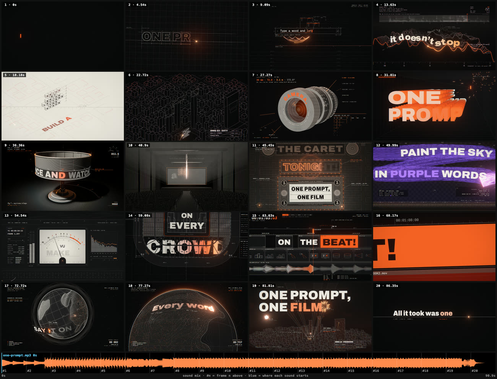

# One Prompt



A 90-second lyric music video where every frame is code: typography, 3D, light, particles and the cut on the beat,
drawn in the browser by WebGL and Canvas 2D. Nothing is pre-rendered; the only media file is the song.

## Open it

From a clone of this repository:

```sh
npx -y openfilm@latest open one-prompt
```

Studio opens the film: eight sections on the picture track, the song below them. To make the MP4:

```sh
cd one-prompt
npx openfilm render          # one-prompt.mp4, 1920×1080 at 30 fps
npx openfilm render --blur   # with motion blur, as the film was meant to be seen
```

The pages load three.js from jsDelivr, so the first open needs a connection.

## How it is built

`film.html` cuts eight pages together, one per section of the song, and plays the song under them:

| Page | Song | Plates (shots) |
| --- | --- | --- |
| `intro.html` | 0 – 7.5 s | "One line": the film's end run backwards, the title as a construction drawing |
| `verse.html` | 7.5 – 26.2 s | the prompt, a ridgeline plot of the song, the model city |
| `pre-chorus.html` | 26.2 – 30.6 s | "Lights, camera, action!": a lamp, a lens, a slate |
| `chorus.html` | 30.6 – 46.3 s | the hook, the zoetrope, the projector beam, the marquee |
| `verse-2.html` | 46.3 – 60.6 s | the painted sky, the mixing desk, the stadium |
| `drop.html` | 60.6 – 68.5 s | the edit timeline: "Cut! Cut! On the beat!" |
| `final-chorus.html` | 68.5 – 85.2 s | the hook again, the globe at night, the premiere |
| `outro.html` | 85.2 – 90.9 s | "All it took was one line", then the OpenFilm mark |

Each page is the same few lines: it calls `section('…')` from `src/section.js`, which makes a WebGL canvas, runs the
film engine (`src/px/`) on that section's plates, and draws song time `start + t` for the page's own time `t`. Every
plate is a pure function of the song's time, so the same moment always draws the same picture.

| Path | What it is |
| --- | --- |
| `src/plates/<plate>.js` | One shot, with its helpers in `<plate>-*.js` (shaders in `-glsl.js`, geometry in `-geo.js`). |
| `src/plates/timeline.js` | Which plate plays when, and which section it belongs to. |
| `src/plates/handoff.js` | The cuts, each on the beat before a line, and what is on screen at each one, so the film plays as one take. |
| `src/lyrics.js` | Every sung word with its start and end (`WORDS`), the lines (`LINES`), the tempo (122 BPM). |
| `assets/data/audio.json` | The song's beats, downbeats, kick / snare / hat onsets and band envelopes, which the plates pulse to. |
| `assets/data/film-sheet.jpg` | A frame of every 24th of a second of the film, which the final chorus shows inside its letters. |
| `src/px/` | The engine: render targets, the post chain (bloom, halation, grain), type, strokes. See [src/px/README.md](src/px/README.md). |

## Change it

- **A lyric line.** Plates find words by their index in `WORDS` (`src/lyrics.js`) and take their timing from there;
  most draw the word from there too, some set their line in the plate itself (the outro's `TEXT` in
  `src/plates/outro.js`, the prompt's tokens in `src/plates/prompt-data.js`). Change the words in `src/lyrics.js`,
  then search `src/plates/` for the old line. The song itself does not change: a new line needs a new song and its
  word times.
- **The colors.** The palette is `HEX` in `src/px/palette.js`: ink, bone, and one signal color, `signal`, the
  caret's orange. Shaders and Canvas 2D both read it, so changing `signal` there recolors the whole film.
- **A shot.** Edit its plate and save; Studio redraws the frame. `npx openfilm look 33.5` draws one moment at full
  size, `npx openfilm look 30-34` a stretch.
- **The cut.** A section's page draws the song's time from where its clip starts, so a clip moved in film.html no
  longer matches the song. To move a cut, change it in `src/plates/handoff.js` and the clip's `at` with it (the
  section times in film.html are those of `sectionSpan` in `src/plates/timeline.js`, to the millisecond).

Credits and licenses: [CREDITS.md](CREDITS.md). The film, its code and its song are MIT.
