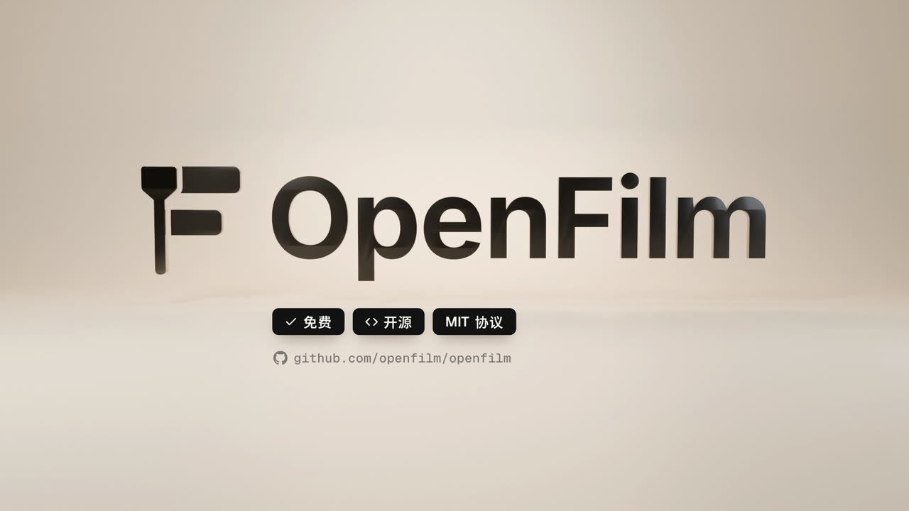

# OpenFilm intro



The 1:42 film that introduces OpenFilm, made with OpenFilm: what it is, what it can make, how you change a film by
clicking it or asking your agent, and how to start. The narration and its subtitles are in Chinese.

## Open it

From a clone of this repository:

```sh
cd openfilm-intro
npx -y openfilm@latest open
```

Or, in Studio: Projects → Import from → GitHub, with
`https://github.com/openfilm/examples/tree/main/openfilm-intro`.

Studio opens the film: the sections on the picture track, the voice, the music and the sound effects below them. To
make the MP4, run `npx openfilm render` in the folder.

## How it is built

`film.html` cuts the sections together and lays the voice-over, the score and the sound effects under them:

| Section | Film | What it shows |
| --- | --- | --- |
| 1 | 0 – 5 s | A desk at night (`assets/video/s1-room.mp4`), into the app (`hero-dark.mp4`) |
| `s2.html` | 5 – 12 s | Any agent becomes an editor: the agents' marks on a bright stage (`s2-cast.mp4`) |
| `s3.html` | 12 – 16.1 s | The OpenFilm mark: free, open source, MIT (`s3-mark.mp4`) |
| `s4.html` | 16.1 – 31.6 s | What it does and what it makes, on a timeline cut on the words |
| `s5.html` | 31.6 – 49.8 s | Click anything in the picture to change it (`s5-ui.mp4`) |
| `s6.html` | 49.8 – 70.8 s | How you use it: a terminal, the agent, Studio, the export (`s6-ui.mp4`) |
| `s7.html` | 70.8 – 102.4 s | Made with it, how to get it, see you (`s7-ui.mp4`) |

| Path | What it is |
| --- | --- |
| `assets/video/` | The rendered shots, the app recordings (`s5-ui`, `s6-ui`, `s7-ui`, a 1600 × 1000 window at 2×) and the films shown as examples (`showcase/`, `showcase-hd/`). |
| `assets/audio/` | The voice-over (`vo/`, each line with its word timings in a `.vtt` beside it), the score (`music/`), the sound effects (`sfx/`). |
| `assets/image/` | Stills for the cards and frames in `s4.html` and `s7.html`. |
| `lib/` | What the pages share: `shared.css` (the fonts and colors), `ease.js`, each section's timing (`s5-voice.json`, `s6-voice.json`, `s6-plan.json`), the filmstrips and waveforms of `s4.html`. |
| `blender/*/out/track.json` | Where the 3D marks are in each frame of `s2-cast.mp4` and `s3-mark.mp4`, so the pages can set their names on them. |
| `fonts/` | Geist, Geist Mono, JetBrains Mono, Noto Sans SC. |

The pages time their moves on the narration's words (the `.vtt` files and `lib/*-voice.json`).

`s7.html` writes its handwritten cards in Hannotate SC and Kaiti SC, which come with macOS; other systems draw them in
another font.

## How it was made

[`make/`](make) holds what made the media: the Blender scenes of sections 1 – 3, the scripts that recorded the
desktop app, the voice-over, the sound design and the early script. [make/README.md](make/README.md) says how each
part was made and how to make it again. The film does not need it to play.

Credits and licenses: [CREDITS.md](CREDITS.md).
